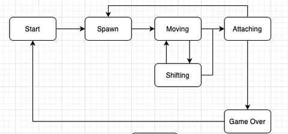

# 🎮 Конечный автомат игры "Тетрис"

  
   
  <em>Диаграмма состояний игры</em>

## 📜 Описание состояний

### 🚦 Старт 
**Состояние ожидания**  
Игра ждет, пока игрок нажмет кнопку готовности к игре.  
*Переход:* Нажатие Start → Спавн

### 🧩 Спавн 
**Создание нового блока**  
- Генерация очередного блока
- Выбор следующего блока для спавна  
*Переходы:*
- Успех → Перемещение
- Коллизия → Игра окончена

### 🎮 Перемещение 
**Основной игровой процесс**  
Обработка действий игрока:
- ↔️ Горизонтальное перемещение
- 🔄 Поворот блоков
- ⏬ Ускоренное падение  
*Переходы:*
- Пауза → Ожидание
- Таймер → Сдвиг
- Конец движения → Соединение

### ⏳ Сдвиг 
**Автоматическое движение**  
Текущий блок перемещается вниз на один уровень по таймеру.  
*Переход:*  
- Любое состояние → Проверка коллизии

### 🧱 Соединение 
**Фиксация блока**  
- Проверка заполненных линий
- Уничтожение полных линий
- Смещение блоков вниз  
*Критическое условие:*  
Если блок в верхнем ряду → Игра окончена

### 💀 Игра окончена 
**Финальное состояние**  
- Показ итогового счета
- Возможность рестарта  
*Переход:*  
Рестарт → Старт

---

  <h3>🕹️ Управление</h3>
  <table>
    <tr>
      <td><strong>← →</strong></td>
      <td>Движение влево/вправо</td>
    </tr>
    <tr>
      <td><strong>↓</strong></td>
      <td>Ускоренное падение</td>
    </tr>
    <tr>
      <td><strong>Пробел</strong></td>
      <td>Поворот фигуры</td>
    </tr>
    <tr>
      <td><strong>P</strong></td>
      <td>Пауза</td>
    </tr>
  </table>

  <a href="classes.html">📚 API Документация</a> | 
  <a href="files.html">📁 Исходные файлы</a>

